# FileManager user manual

FileManager is a Windows desktop app that holds three tools:

- **[Tar Packager](#tar-packager)**: builds a Linux tar archive from Windows
  files, with the paths, permissions and owners that a manifest file lists.
- **[Schedule Creator](#schedule-creator)**: reads a schedule from a text file
  and adds it to an existing XML file.
- **[Pipeline](#pipeline)**: runs a fixed series of steps over every subfolder
  of a folder you choose.

> **Development status.** The Tar Packager is complete. The Schedule Creator
> and the Pipeline have a finished interface, but the work behind them is not
> written yet. In this build, **Add to XML** reports *"Reading schedule files is
> not implemented yet"* and a Pipeline step reports *"Not implemented"*.
> Nothing is changed on disk in either case. Each section below says what you
> will see.

## Contents

1. [Getting started](#getting-started)
2. [Tar Packager](#tar-packager)
   - [Opening a manifest](#opening-a-manifest)
   - [The file list](#the-file-list)
   - [Choosing the Windows files](#choosing-the-windows-files)
   - [Choosing the output file and format](#choosing-the-output-file-and-format)
   - [Creating the archive](#creating-the-archive)
   - [The build result](#the-build-result)
   - [Partial archives](#partial-archives)
   - [When the manifest has errors](#when-the-manifest-has-errors)
   - [Other messages](#other-messages)
   - [Extracting the archive on the Linux target](#extracting-the-archive-on-the-linux-target)
   - [Writing a manifest](#writing-a-manifest)
   - [What the app remembers](#what-the-app-remembers)
   - [Keyboard shortcuts](#keyboard-shortcuts)
   - [Developer mode](#developer-mode)
3. [Schedule Creator](#schedule-creator)
4. [Pipeline](#pipeline)
5. [Entering paths](#entering-paths)
6. [Accessibility](#accessibility)
7. [Troubleshooting](#troubleshooting)

---

## Getting started

### Requirements

- Windows 10 or 11, 64-bit.
- Microsoft Edge WebView2 Runtime. It is part of Windows 11 and of current
  Windows 10 updates. If the app does not open, install the WebView2 Runtime
  from Microsoft.

### Installing and starting

FileManager is a single portable program, `FileManager-<version>-x64.exe`.
There is no installer.

1. Copy the `.exe` to any folder, for example `C:\Tools\FileManager\`.
2. Double-click it.

To remove the app, delete the `.exe`.

### The window

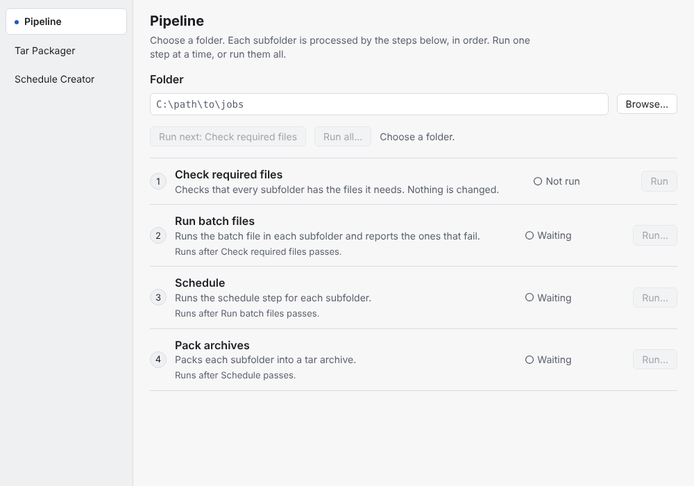

The list on the left holds the three tools. Click a tool's name, or move to the
list with **Tab** and use the **Up** and **Down** arrow keys, to switch tools.
The app opens on the Pipeline.

You can switch tools at any time. The files and folders you chose in a tool
stay chosen when you come back; messages and results shown on screen are
cleared.

---

## Tar Packager

The Tar Packager builds a `.tar` archive, optionally compressed, for a Linux
machine. A **manifest** lists every file that belongs in the package, where it
goes on the Linux machine, and its permissions and owner. You choose the
actual Windows file for each entry, then click **Create archive**.

A typical session:

1. Open the manifest.
2. Drop the build output folder on the window to fill in the files.
3. Choose where to save the archive.
4. Click **Create archive**, then check the result.

### Opening a manifest

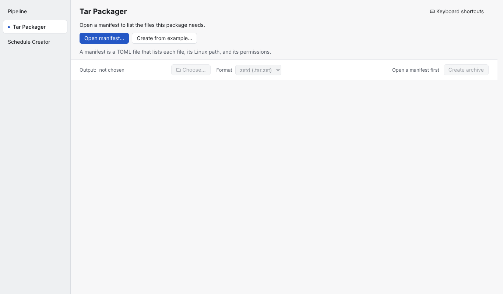

When no manifest is open:

- **Open manifest…** (**Ctrl+O**) opens a `.toml` manifest.
- **Create from example…** saves a commented example manifest at a location
  you choose and opens it. Use it as the start of a new manifest; see
  [Writing a manifest](#writing-a-manifest). It never replaces an existing
  file. Choose a new name if one is already there.

Once a manifest is open, its name and full path appear at the top, with these
buttons:

| Button | What it does |
| --- | --- |
| **Open…** | Opens another manifest (**Ctrl+O**). |
| **Recent** | Lists manifests you opened before. Pick one to open it. |
| **Reload** | Reads the manifest again from disk (**F5** or **Ctrl+R**). Use it after you edit the manifest. |
| **Keyboard shortcuts** | Lists the shortcuts. See [Keyboard shortcuts](#keyboard-shortcuts). |

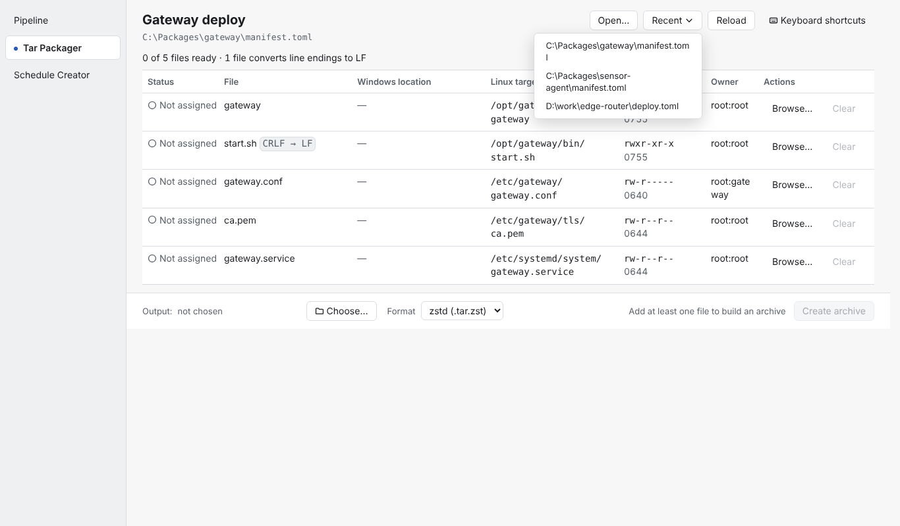

When you start the app, the Tar Packager reopens the last manifest you used.

### The file list

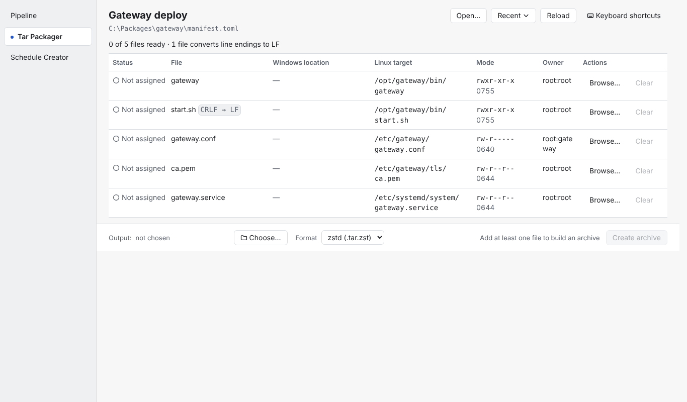

The line above the table sums up the list, for example *"0 of 5 files ready ·
1 file converts line endings to LF"*. The table has one row per file in the
manifest:

| Column | Meaning |
| --- | --- |
| **Status** | **Ready**: a file is chosen and found. **Not assigned**: no file chosen yet. **Missing**: the chosen file is no longer on disk. |
| **File** | The file name the manifest expects. **CRLF → LF** means Windows line endings in this file are turned into Linux line endings in the archive. |
| **Windows location** | The file you chose. A long path is shortened in the middle; hover over it to see the whole path. |
| **Linux target** | The full path the file gets inside the archive and on the Linux machine. |
| **Mode** | Its permissions, as letters (`rwxr-xr-x`) and as octal digits (`0755`). |
| **Owner** | Its owner and group (`root:root`). |
| **Actions** | **Browse…** chooses the file. **Clear** forgets the chosen file. Clear never deletes anything. |

In a narrow window the table becomes a list, with the same information in each
row.

### Choosing the Windows files

You can choose files in two ways, and mix them.

**Drop files or folders on the window.** Drag files, or the folder that holds
them, from File Explorer onto the app. While you drag, the window shows where
the files will go:

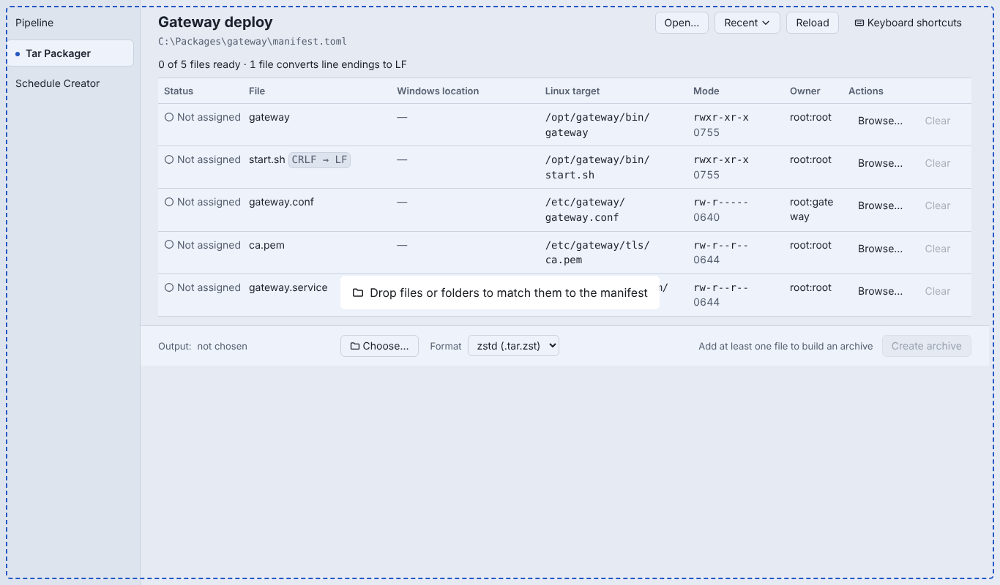

The app matches each dropped file to a manifest entry by file name. Upper and
lower case are treated alike. A dropped folder is searched, with its
subfolders, up to eight levels deep. Shortcuts and links are not followed.

After the drop, a summary says what happened:

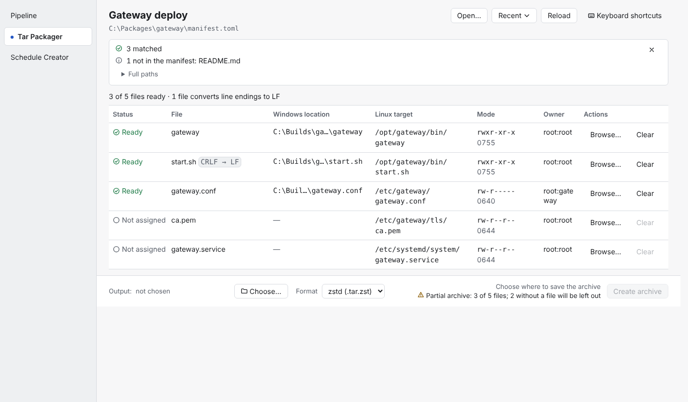

| Line | Meaning |
| --- | --- |
| *N matched* | These files were assigned to their rows. |
| *not in the manifest* | A dropped file whose name is not in the manifest. It is ignored. |
| *already assigned, left unchanged* | The row already had a file that is Ready. **A drop never replaces a file you already chose.** Use Browse… or Clear first to change it. |
| *ambiguous, not assigned* | Two files with the same name were dropped, or two entries expect the same name. Nothing was assigned. Use **Browse…** on those rows. |
| *folders with nothing to match* | A dropped folder held no file the manifest lists. |
| *links not followed* | A shortcut, symbolic link or junction was dropped. Drop the real file or folder instead. |
| *no longer found* / *could not be read* | The file disappeared or Windows refused access to it. |
| *unsupported characters in its path* | The path contains characters Windows allows but the app cannot store. Rename the file or its folder. |

Click **Full paths** to see the complete paths. Close the summary with **×**
or **Esc**.

**Browse for one file.** Click **Browse…** on a row (or focus the row and press
**Enter**) and pick the file. Use this to replace a file, or for rows a drop
reported as ambiguous.

**Clear** (or **Delete** on a focused row) forgets the row's file. The file on
disk is not touched.

### Choosing the output file and format

The bar at the bottom of the tool holds the build settings:


- **Output** and **Choose…**: where to save the archive. The Save dialog
  suggests the name from the manifest (`output_name`), or the last location you
  used for this manifest.
- **Format**: the archive type.

| Format | Extension | Notes |
| --- | --- | --- |
| tar | `.tar` | No compression. |
| gzip | `.tar.gz` | Widely supported. |
| zstd | `.tar.zst` | **Recommended** for the target: smallest decompression time. Needs GNU tar 1.31 or newer and `zstd` on the target. |
| xz | `.tar.xz` | Smallest files; slowest to unpack. |

Changing the format changes the output file's extension to match. If you type
a file name in the Save dialog that ends in another archive extension, the
format follows the name.

### Creating the archive

When everything is ready, **Create archive** (**Ctrl+Enter**) turns blue:

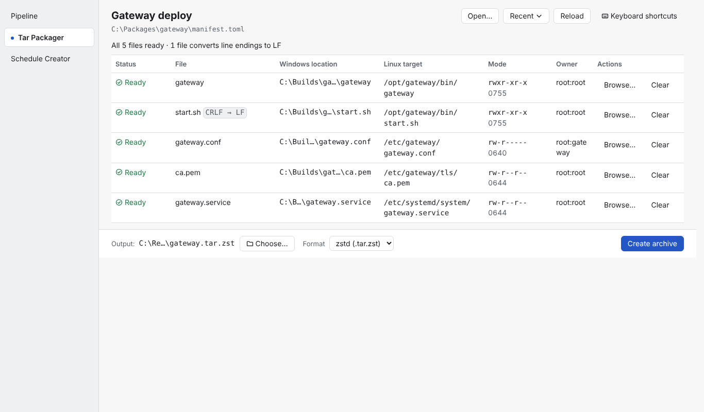

If it is grey, the text next to it says what is missing:

| Message | What to do |
| --- | --- |
| *Open a manifest first* | Open a manifest. |
| *Add at least one file to build an archive* | Choose at least one Windows file. |
| *Choose where to save the archive* | Click **Choose…** next to Output. |
| *N chosen files are missing from disk* | A chosen file was moved or deleted. Browse for it again, or Clear it. |
| *No files can be built until the manifest errors are fixed* | See [When the manifest has errors](#when-the-manifest-has-errors). |
| *This manifest lists no files* | Add a `[[file]]` entry to the manifest, then Reload. |

While the archive is written, a progress bar shows the step and the current
file. There are two steps: **writing** the archive, then **verifying** it by
reading it back. Every control is locked until both are done.

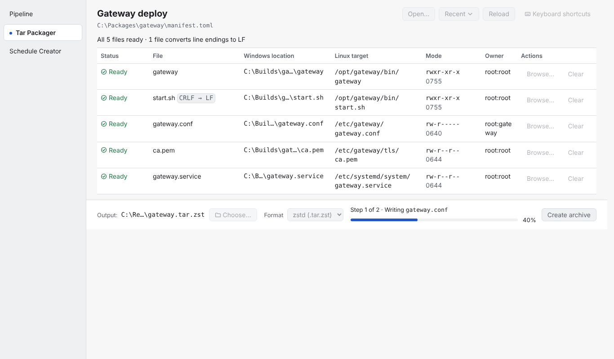

The archive is written to a temporary file first. It is saved under the chosen
name only after it passes verification, so a failed build never leaves a
broken archive behind.

**If the output file already exists,** the app asks before replacing it:

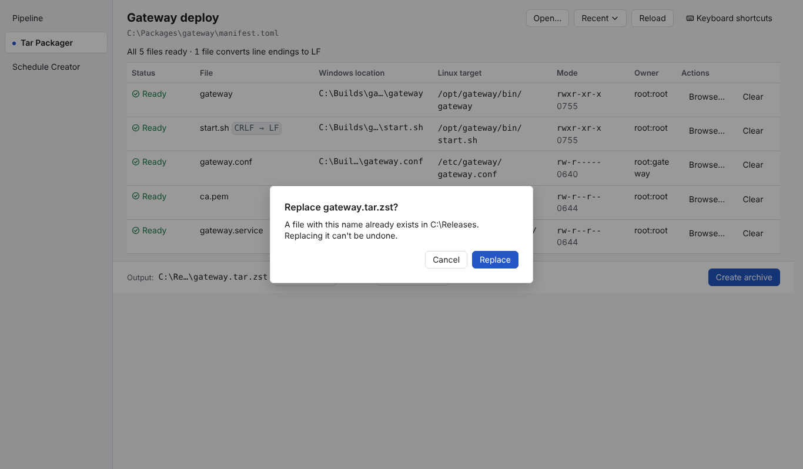

Click **Replace** to overwrite it, or **Cancel** to keep it and choose another
name.

### The build result

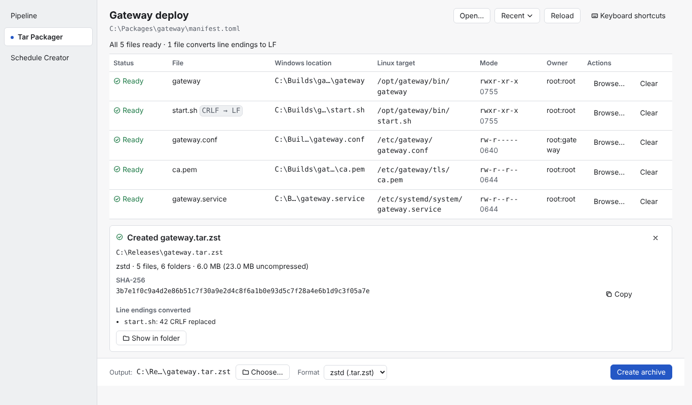

The result shows:

- the archive's name and full path;
- the format, the number of files and folders, and the size, compressed and
  uncompressed;
- the archive's **SHA-256** checksum, with **Copy**. Compare it on the target
  with `sha256sum <file>` to make sure the file arrived intact;
- **Line endings converted**: how many Windows line endings were changed in
  each file marked CRLF → LF;
- **Show in folder**: opens File Explorer with the archive selected.

Close the result with **×** or **Esc**. It also goes away when you reload the
manifest.

### Partial archives

You do not have to choose every file. Rows with no file are left out of the
archive. The build bar warns you before you build:

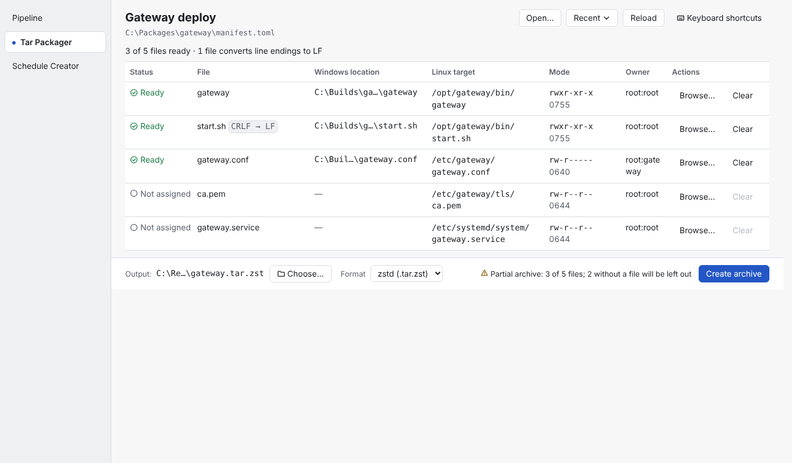

The result names the files that were not included, and offers **Copy report**
to copy the full report as text:

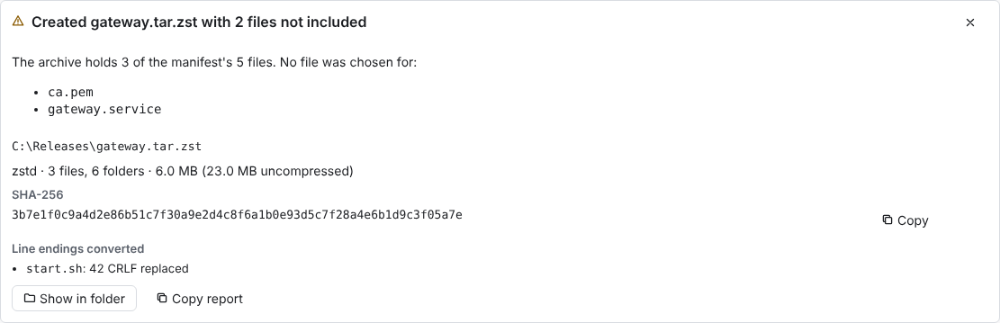

A **Missing** file is different: if a file you chose has disappeared, the
build is blocked, so a file is never left out by accident. Browse for it again
or clear it.

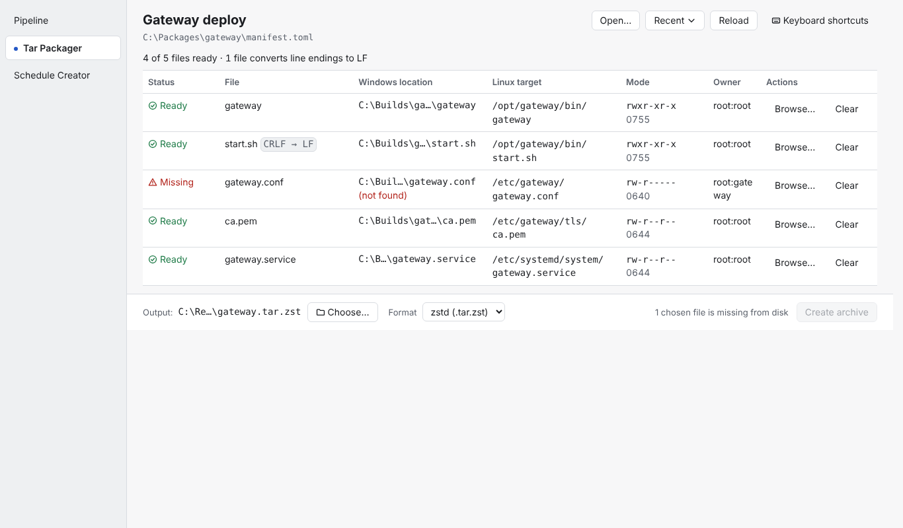

### When the manifest has errors

The manifest is checked every time it is opened or reloaded. Problems appear
in a red box above the file list, each with its line and column in the
manifest (`35:7` is line 35, column 7):

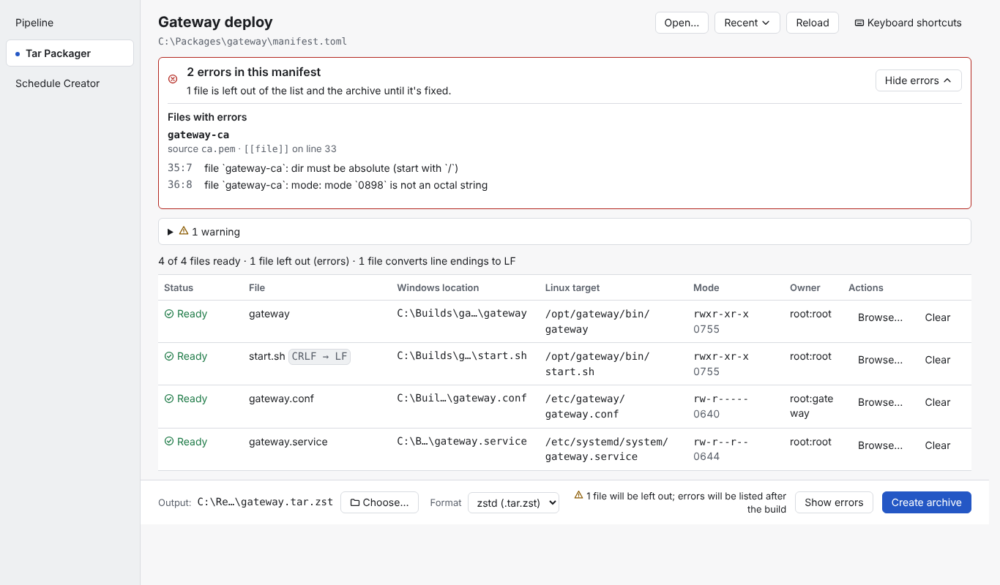

- **Errors in one file entry** take only that file out of the list and the
  archive. You can still build the other files. The build bar says how many
  files will be left out, and the build result lists the errors again.
- **Errors in the manifest as a whole** (for example a misspelt section name,
  or a problem in `[defaults]`) hide every file, because none of them can be
  trusted. Nothing can be built until they are fixed.

  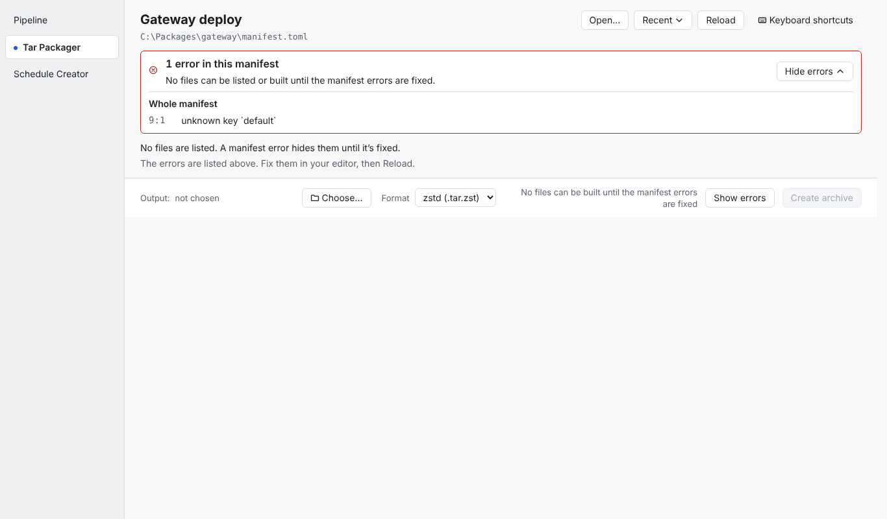

- **Warnings** (the yellow line) never block a build. Click to expand them.
  For example, two entries whose file names differ only in case cannot be
  told apart by a drop, so you choose their files with Browse….

**Show errors** (**F8**) jumps to the error list. **Hide errors** collapses it.

To fix errors, edit the manifest in any text editor, save it, then click
**Reload**. The full list of rules and messages is in the
[manifest reference](../tarpack-manifest.md#diagnostics).

### Other messages

**The manifest changed on disk.** The app watches the open manifest. When it is
saved by another program, a yellow banner appears. Click **Reload** to read the
new version. A build started from the old version is refused until you reload.

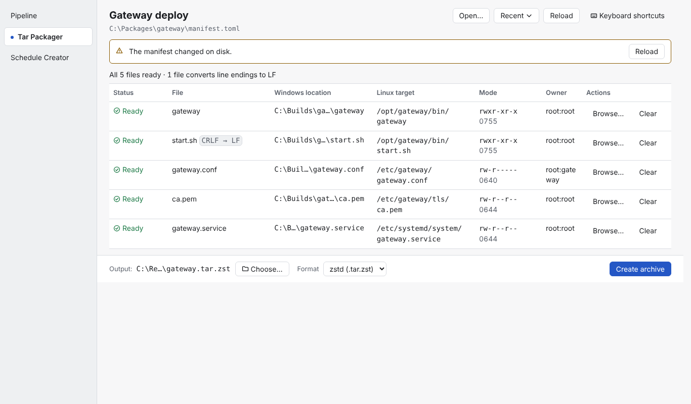

**Errors from an action** appear in a red banner at the top of the tool. Click
**Details** for the technical message, or **×** to close it. Common ones:

| Message | Meaning |
| --- | --- |
| *… is no longer at its assigned location.* | A chosen file was moved or deleted after you chose it. |
| *… changed while the archive was being written. Nothing was saved.* | A file was being modified during the build. Try again. |
| *The archive failed its check after writing, so it was not saved.* | Verification failed. Any existing file was left unchanged. Try again. |
| *The manifest could not be read.* | The manifest was moved, deleted, or is locked. |

**Information banners** (blue) report something the app could not remember or
restore, for example a recent manifest that no longer exists. Close them with
**×**.

### Extracting the archive on the Linux target

Files are stored in the archive with **absolute paths**
(`/opt/gateway/bin/gateway`). Copy the archive to the Linux machine, then, as
root, in the folder that holds it:

```sh
tar --no-overwrite-dir -xpPf archive.tar                # .tar
tar -z --no-overwrite-dir -xpPf archive.tar.gz          # .tar.gz
tar --zstd --no-overwrite-dir -xpPf archive.tar.zst     # .tar.zst
tar -J --no-overwrite-dir -xpPf archive.tar.xz          # .tar.xz
```

- `-P` is **required**. Without it, tar strips the leading `/` and unpacks
  everything below the current folder instead.
- `-p` applies the permissions, and as root also the owners.
- `--no-overwrite-dir` keeps the permissions of folders that already exist,
  such as `/etc`.

To list the contents without extracting, replace `-xpPf` with `-tvPf`.

### Writing a manifest

A manifest is a text file in [TOML](https://toml.io) format. Start from
**Create from example…**, which produces this:

```toml
version = 1
name = "Gateway deploy"
output_name = "gateway.tar.zst"

[defaults]
mode = "0644"
dir_mode = "0755"
uid = 0
gid = 0
uname = "root"
gname = "root"

[[file]]
id = "gateway-bin"
source = "gateway"
dir = "/opt/gateway/bin"
mode = "0755"

[[file]]
id = "gateway-conf"
source = "gateway.conf"
dir = "/etc/gateway"
mode = "0640"
gname = "gateway"
gid = 990

[[file]]
id = "gateway-start"
source = "start.sh"
dir = "/opt/gateway/bin"
mode = "0755"
normalize_eol = true
```

- `name` is shown at the top of the tool. `output_name` is the suggested file
  name when saving, and its extension picks the default format.
- `[defaults]` sets the permissions and owner every file gets unless it says
  otherwise. `dir_mode` is used for the folders the archive creates.
- Each `[[file]]` block is one row:
  - `id`: a unique key. The app remembers the chosen Windows file against it,
    so keep it stable.
  - `source`: the Windows file name to expect. Drops are matched on it.
  - `dir`: the Linux folder the file goes into. Must start with `/`.
  - `name` (optional): a different file name inside the archive.
  - `mode`, `uid`, `gid`, `uname`, `gname` (optional): override the defaults.
  - `normalize_eol = true` (optional): turn Windows line endings (CRLF) into
    Linux ones (LF). Use it for shell scripts and config files edited on
    Windows. Leave it off for binaries.

The complete reference, with every rule and error message, is
[tarpack-manifest.md](../tarpack-manifest.md).

### What the app remembers

For each manifest, the app remembers the Windows file chosen for each entry,
the last output path, and the last format. They come back when you open the
manifest again. The memory is tied to the manifest's location: if you move or
rename the manifest file, it starts fresh.

### Keyboard shortcuts

Click **Keyboard shortcuts** to see this list in the app.

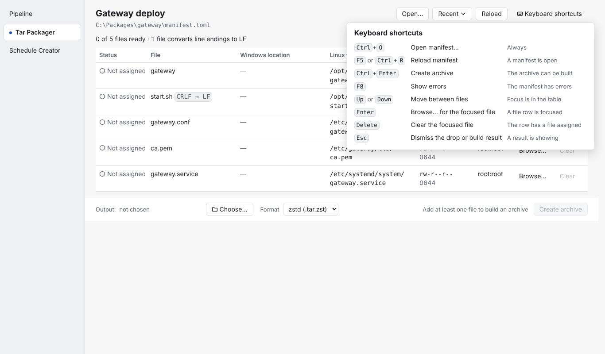

| Keys | Action | Active when |
| --- | --- | --- |
| **Ctrl+O** | Open manifest… | Always |
| **F5** or **Ctrl+R** | Reload manifest | A manifest is open |
| **Ctrl+Enter** | Create archive | The archive can be built |
| **F8** | Show errors | The manifest has errors |
| **Up** / **Down** | Move between files | Focus is in the table |
| **Enter** | Browse… for the focused file | A file row is focused |
| **Delete** | Clear the focused file | The row has a file assigned |
| **Esc** | Dismiss the drop or build result | A result is showing |

### Developer mode

Developer mode is meant for the people who maintain manifests. Press
**Ctrl+Alt+Shift+D** to turn it on or off. It is always off when the app
starts.

In developer mode:

- **Edit in editor** (**Ctrl+E**) opens the manifest in its default editor.

  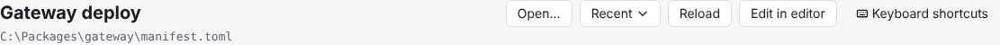

- The build result also shows the exact **extraction command** for the
  archive, with **Copy**:

  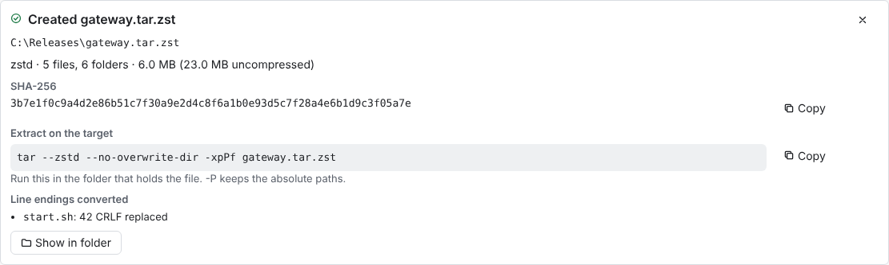

---

## Schedule Creator

The Schedule Creator reads a schedule from a text file and adds it to an
existing XML file. It saves a backup of the XML file before changing it.

> **In this build** the reading and merging are not implemented yet. After you
> confirm, the app reports *"Reading schedule files is not implemented yet.
> Nothing was changed."* No backup is made and the XML file is not touched.

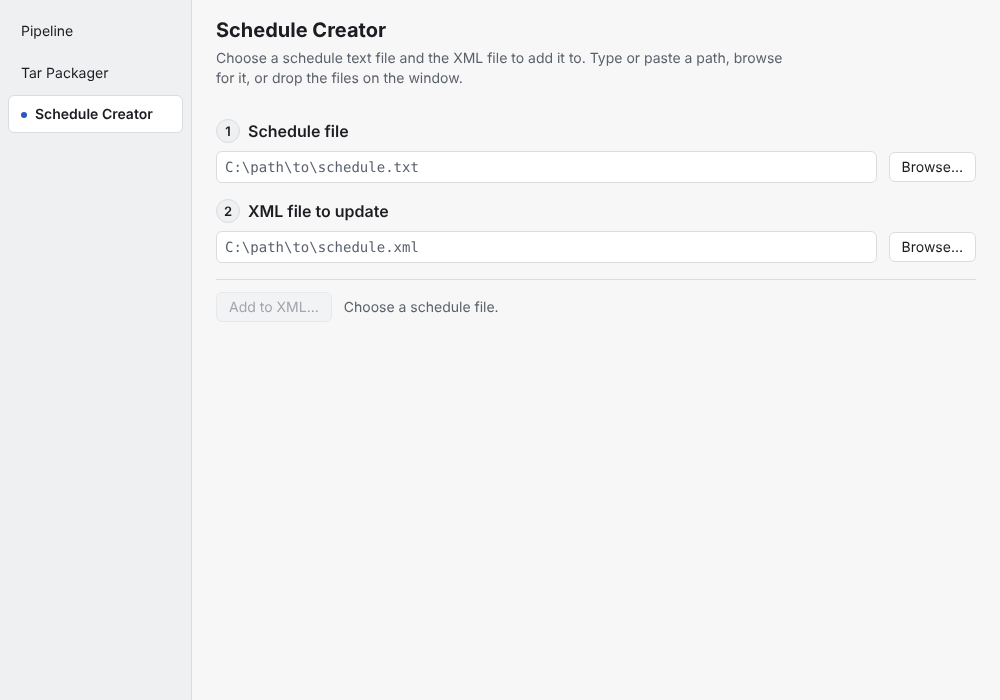

### 1. Choose the two files

For **Schedule file** and **XML file to update**, either:

- type or paste the path in the field (see [Entering paths](#entering-paths)),
- click **Browse…**, or
- drop the files on the window. A file ending in `.xml` becomes the XML file;
  any other file becomes the schedule file. You can drop both at once. If you
  drop two files of the same kind, nothing changes and the app says so.

A path that cannot be used is outlined in red, with the reason under it, and
**Add to XML…** stays disabled until it is fixed:

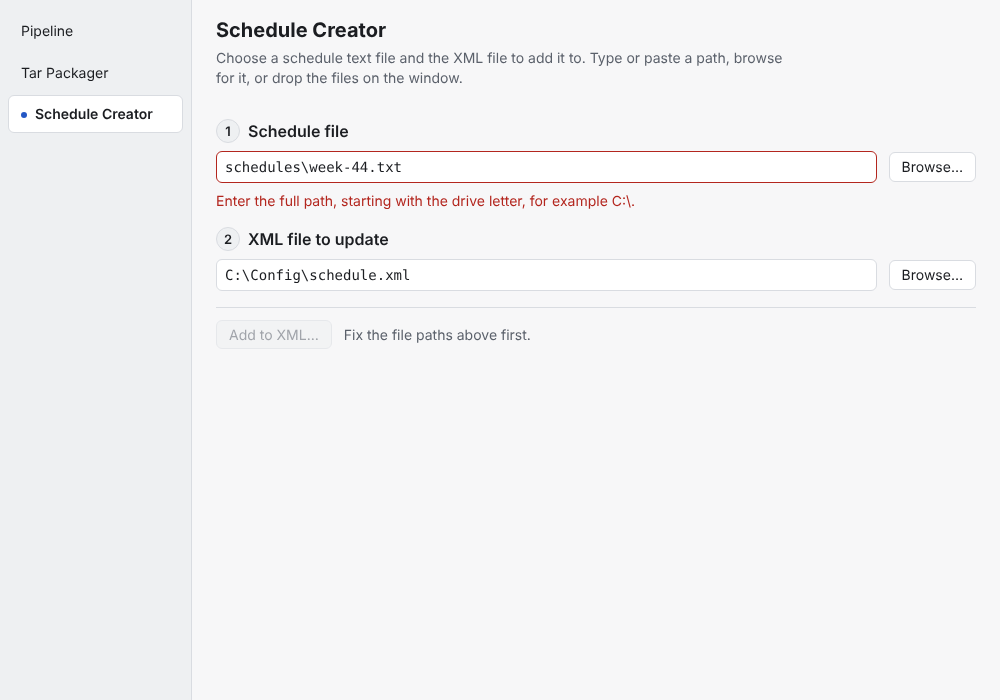

The files must be full paths to existing files saved as UTF-8 text.

### 2. Add to XML

When both files are set, click **Add to XML…**.

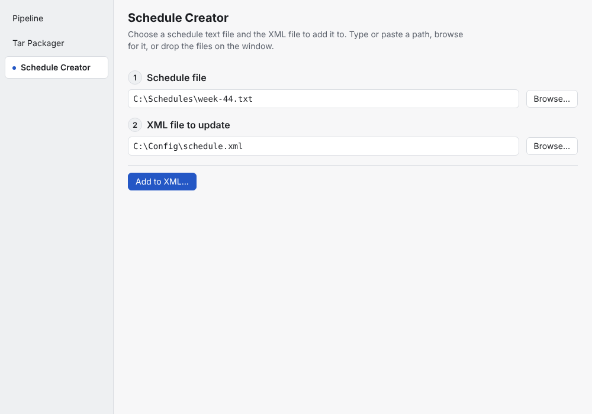

A confirmation names both files. Click **Update** to go ahead, or **Cancel**.

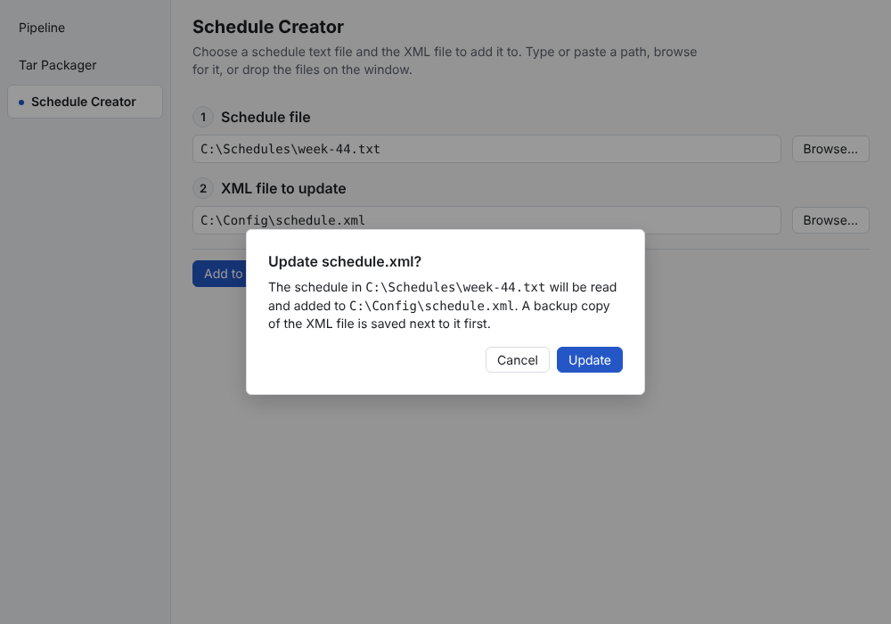

If you already added this schedule to this XML file during this session, the
confirmation warns you that adding it again may duplicate its entries.

When you click **Update**, the app:

1. reads the schedule file as it is now;
2. reads the XML file and adds the schedule to it;
3. saves a copy of the original XML next to it, for example
   `schedule.xml.bak` (or `schedule.xml.bak.1`, `schedule.xml.bak.2`, … if
   that name is taken: an existing backup is never replaced);
4. replaces the XML file in a single step, so it is never left half-written.

If any step fails, nothing is written, and a red banner says why. A problem in
the schedule file names its line number. In this build, the banner reads:

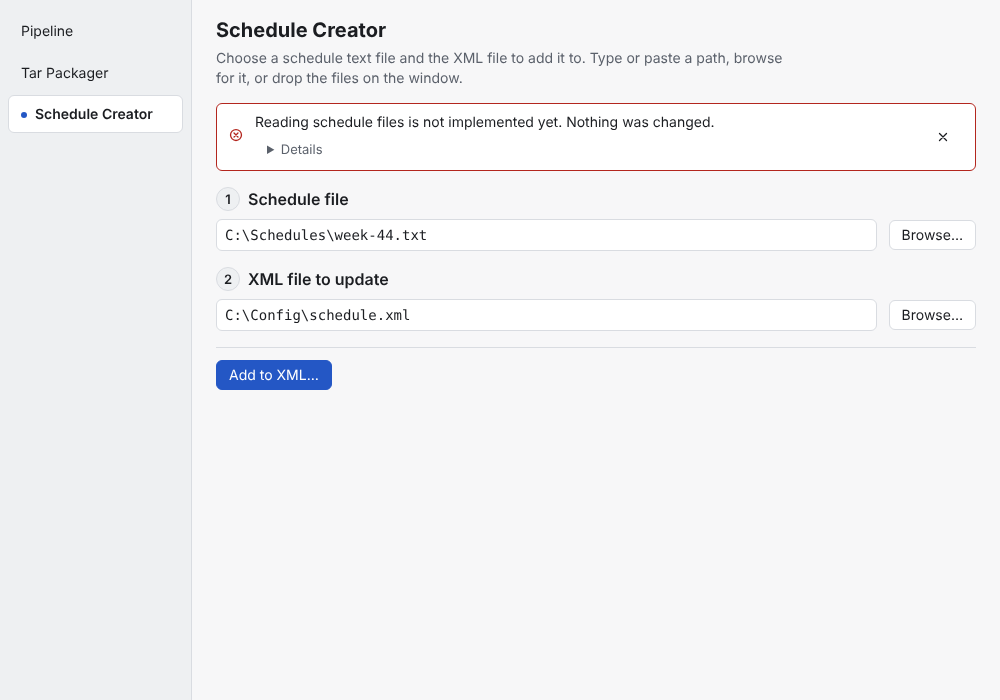

Once implemented, a successful update shows *"Added N entries to
schedule.xml."* with the path of the backup.

**Notes**

- If you change either file between confirming and the update starting, the
  update is refused with *"The chosen files changed after you confirmed"* and
  nothing is written.
- The updated XML file is a new file: special Windows permissions or
  attributes set on the old file are not carried over. If the XML file was a
  link, it is replaced by a normal file.

---

## Pipeline

The Pipeline runs a fixed sequence of four steps over a folder. Each
subfolder directly inside it is one unit of work, for example one delivery.

| # | Step | What it does | Asks first |
| --- | --- | --- | --- |
| 1 | **Check required files** | Checks that every subfolder has the files it needs. Nothing is changed. | No |
| 2 | **Run batch files** | Runs the batch file in each subfolder and reports the ones that fail. | Yes |
| 3 | **Schedule** | Runs the schedule step for each subfolder. It may update files. | Yes |
| 4 | **Pack archives** | Packs each subfolder into a tar archive. | Yes |

> **In this build** the steps are not implemented. Running step 1 shows
> **Not implemented** and *"This step is not implemented yet."* Because step 1
> never passes, steps 2 to 4 stay **Waiting**. Nothing is changed on disk.

### 1. Choose the folder

Type or paste the folder's path, or click **Browse…**. The number of
subfolders appears under the field.


A path that is not a folder, is not a full path, or cannot be read, is
outlined in red with the reason, and nothing can run:

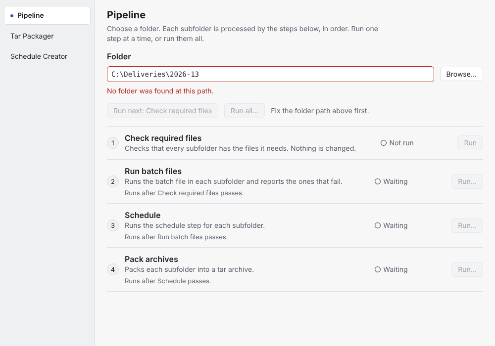

Choosing another folder forgets every step's result.

### 2. Run the steps

The steps must pass **in order**. A step's **Run** button is enabled only when
every step before it has passed; until then it shows **Waiting** and *"Runs
after … passes."*

- **Run next: <step>** runs the first step that has not passed yet. Press it
  repeatedly to walk through the whole process. When every step has passed it
  is disabled and says *"All steps passed."*
- **Run** on a step runs that step only. Running a step again (for example
  after fixing a subfolder) also clears the results of every later step, which
  then have to run again.
- **Run all…** runs every step from the first, in order, and stops at the
  first step that does not pass.

Steps that can change files (2, 3 and 4) ask for confirmation first, naming
the folder. **Run all…** asks once, listing everything that will happen:

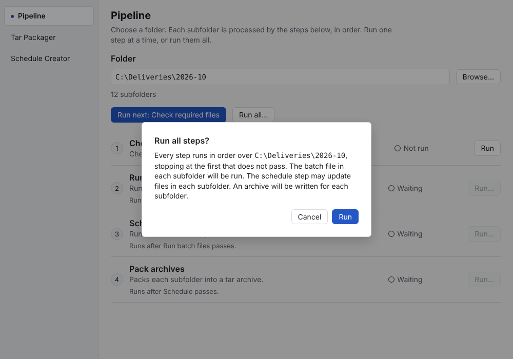

While a step runs, its status shows **Running…** and the folder field and
every button are locked. You can switch to another tool; when you come back,
the Pipeline shows the step still running. **Run all** does not start further
steps after you leave the Pipeline.

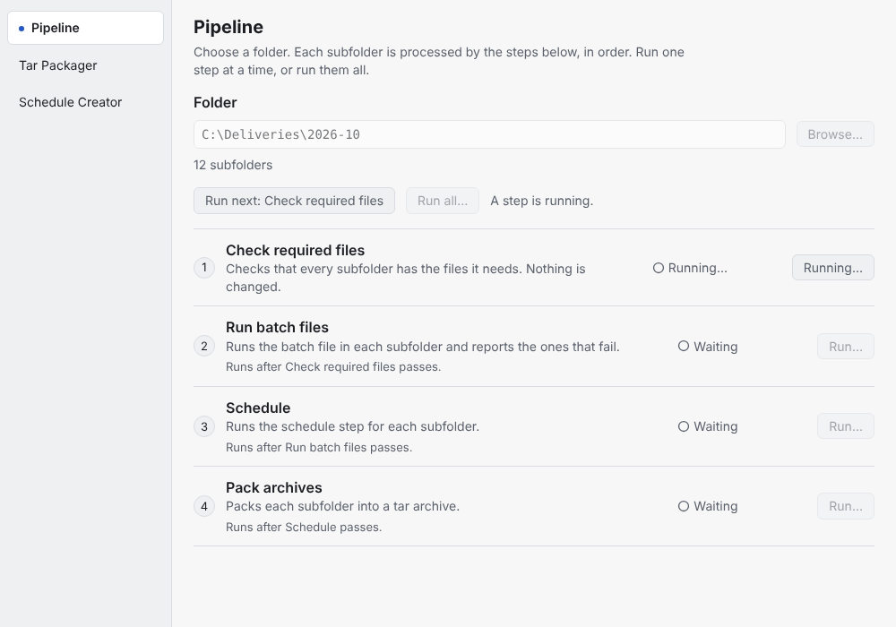

### 3. Read the results

Each step shows its last result:

| Status | Meaning |
| --- | --- |
| **Not run** | The step can run but has not yet. |
| **Waiting** | An earlier step has not passed. |
| **Running…** | The step is running now. |
| **Passed** | The step finished and found no problems. Its summary appears under it, for example *"12 folders checked"*. |
| **N problems** | The step finished but found problems. Each one is listed with the subfolder it concerns. Fix them and run the step again. |
| **Failed** | The step stopped before it finished. Click **Details** for the reason. |
| **Not implemented** | The step is not written yet (this build). |

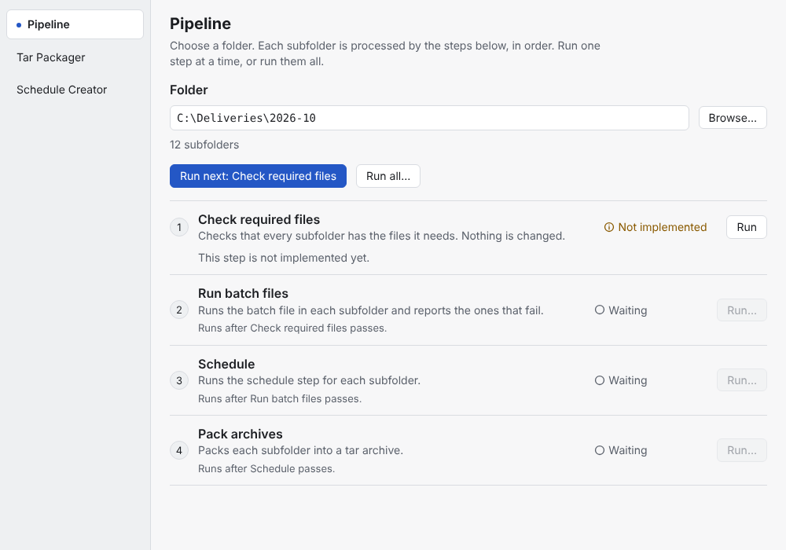

---

## Entering paths

The Schedule Creator and the Pipeline have path fields. In every path field:

- The path is used when you press **Enter** or leave the field.
- Paste freely: the quotes that File Explorer's **Copy as path** adds are
  removed.
- **Esc** puts back the path that was there before you started typing.
- Clearing the field and pressing **Enter** removes the file or folder.
- Paths must be **full paths**, starting with a drive letter (`C:\…`) or a
  network share (`\\server\share\…`). A relative path like
  `schedules\week.txt` is rejected, because it is not clear which folder it is
  relative to.

---

## Accessibility

- Every control can be reached and used with the keyboard. **Tab** moves
  between controls; in the Tar Packager's file table, **Up** and **Down** move
  between rows.
- Every control has a name for screen readers. Status changes (a drop result,
  build progress and result, errors, developer mode on or off) are announced.
- The app follows Windows text size and works at 200% zoom; tables become
  lists in narrow windows.
- Animations are reduced when **Show animations in Windows** is turned off.

---

## Troubleshooting

| Problem | Solution |
| --- | --- |
| The app does not start, or opens a blank window. | Install or repair the Microsoft Edge WebView2 Runtime. |
| A drop does nothing. | Open a manifest first (Tar Packager), and wait for any build or confirmation to finish. The overlay that appears while dragging says why a drop is not accepted. |
| A dropped file was not assigned: *already assigned*. | Drops never replace a file you chose. **Clear** the row, then drop again, or use **Browse…**. |
| A file I expected is not in the list. | It has an error in the manifest. See the red box, fix the manifest, then **Reload**. |
| **Create archive** stays grey. | Read the text next to it; see [Creating the archive](#creating-the-archive). |
| The files I chose last time are gone. | The manifest was moved or renamed. The app remembers choices per manifest location. |
| On Linux, the files were extracted into the current folder. | `-P` was missing from the `tar` command. See [Extracting the archive](#extracting-the-archive-on-the-linux-target). |
| `tar: unrecognized option '--zstd'` on the target. | The target's tar is older than 1.31 or `zstd` is not installed. Build a `.tar.gz` instead, or run `zstd -d archive.tar.zst` first, then extract the `.tar`. |
| A path with unusual characters cannot be dropped. | Rename the file or folder, or use **Browse…**. |

---

*Screenshots are generated from the real interface; see
[screenshots/README.md](screenshots/README.md) to regenerate them.*
